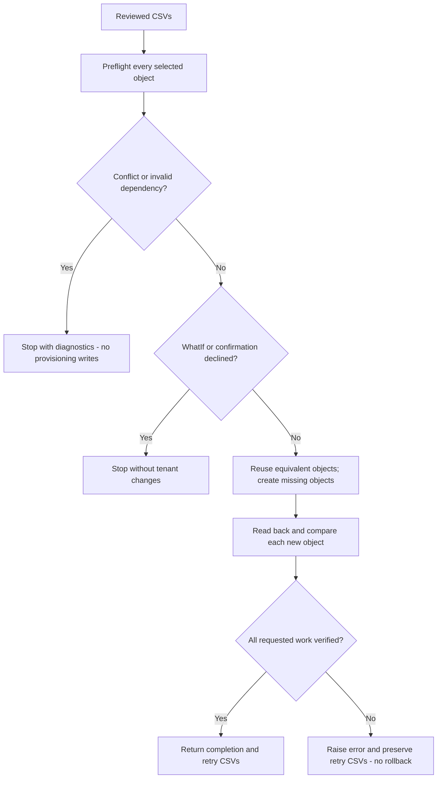

# Web Filtering OMv2: Decisions

Recorded: 2026-10-27 | Updated: 2026-10-30

Status: Implemented design, pending technical review and live end-to-end validation.

## Context

Migrate2GSA currently converts vendor configurations into reviewable OMv1 CSVs.
Web Filtering OMv2 uses ordered rules with individual actions and an explicit
policy default. This record explains how the toolkit supports that model without
replacing OMv1 or claiming automatic policy equivalence. See the companion
[Plan](OMv2-Plan.md) for the workflow, evidence, and rollout gates.

## 1. Add an explicit V2 path, not a replacement

**Decision:** Keep existing vendor converters and OMv1 defaults. Add the offline
`ConvertTo-EntraInternetAccessV2Plan` stage and select V2 provisioning/export with
`-PolicyModel OMv2`.

**Rationale and tradeoff:** A shared conversion stage reuses existing migration
outputs and avoids changing each vendor converter. It preserves the CSV/Excel
review workflow, at the cost of another review step. It cannot reconstruct source
conditions or runtime state that an earlier conversion did not retain.

Scope is Web Filtering V2 only. Traffic Forwarding V2, TLS inspection, threat
intelligence, and cloud firewall conversion remain separate concerns. Missing
feature support or API failures must be reported; never fall back to OMv1.

## 2. Preserve profile-specific order and provenance

**Decision:** Generate one `<SecurityProfileName>-WebFilteringV2` policy per
source security profile. Sort its web-policy links by numeric priority, retain
CSV row order within each source policy, and assign rule priorities 100, 200,
300, and so on. Each rule inherits its source policy's Allow/Block action.

**Rationale and tradeoff:** This gives each profile an explicit ordered rule set,
rather than carrying OMv1's policy-level action into an incompatible model.
Shared source policies are expanded independently per profile, which can increase
rule counts and makes target service-limit checks necessary.

The versioned contract is `EIA-OMv2/1.0`: policy/rule rows plus profile/link rows,
with source provenance and review notes. The earlier `EIA-OMv2-Plan/0.1` contract
is rejected rather than interpreted ambiguously. Unsupported or omitted inputs
remain visible for review; they are not silently treated as a complete migration.

## 3. Require explicit evaluation and activation choices

**Decision:** Require an operator-selected proposed policy default and review of
destinations, assignments, and runtime state before provisioning.

| Choice | Reason and consequence |
|---|---|
| Allow, Block, or ContinueEvaluation default | No single default is safe for every migration. The default applies when no rule matches; ContinueEvaluation is not a rule action. |
| ContinueEvaluation requires review | It continues to the next applicable profile; with no next profile, traffic is implicitly allowed. Baseline priority 65000 must use Allow or Block. |
| Keep OMv1 links untouched | Avoid an implicit cutover. An applicable OMv1 policy may still block traffic allowed by OMv2. |
| Preserve FQDN text when proposing URL rules | Host, wildcard, root-domain, and path matching may differ. Do not invent a wildcard rewrite or claim equivalence. |
| Separate review, selection, and state | Generated rows start `ReviewNeeded=Yes`, `Provision=No`; rules/profiles are disabled, while generated links are enabled. `Provision` never establishes source or target runtime state. |

Explicit Allow/Block decisions terminate V2 evaluation; they do not override
coexisting OMv1 enforcement. These semantics guide the design, but target-tenant
traffic tests are still required. See Microsoft's
[web-filtering model](https://learn.microsoft.com/en-us/entra/global-secure-access/concept-web-filtering).

## 4. Create missing objects; refuse destructive reconciliation

**Decision:** Compare all selected configuration before the first write. Reuse
equivalent objects, create missing objects, and stop on meaningful differences.

Equivalence includes defaults, descriptions, rule order/actions/destinations/state,
profile settings, web links, and requested CA conditions. Ignore service-generated
IDs/timestamps and empty optional values, but retain meaningful settings and URL
case. Reject duplicate names, priority collisions, different-policy links, and
extra rules inside a selected existing policy. Unrelated tenant objects and
non-web/OMv1 links remain untouched.

**Rationale and tradeoff:** Name-only reuse could accept drift; overwrite/delete
could alter effective access. Conservative comparison is safer but intentionally
blocks updates. Automatic reconciliation needs a separately reviewed mode.

Preflight is not a transaction or lock. Concurrent edits and partial failures can
leave created objects behind. Successfully verified rows become `Provision=No`
in new retry CSVs; failed/unattempted selections remain `Yes`. Keep both retry
files together and rerun to rediscover objects. Inputs are not overwritten, and
errors remain terminating. `-WhatIf` reads tenant state but makes no Graph writes
or retry CSVs; `-Force` bypasses confirmation, not validation.

## 5. Treat assignments and exports as reviewed configuration

**Decision:** Support optional profile/link/CA provisioning, while allowing a
policy-only run or `-SkipCAPoliciesProvisioning` to limit scope.

Simplified user/group assignments must resolve uniquely. They create disabled
CA policies with all client app types explicitly specified, avoiding a false
comparison conflict with Graph's default. Full exported
`ConditionalAccessPoliciesJson` takes precedence over simplified assignments and
preserves exclusions, conditions, and state, including Enabled. Only the target
profile reference is rebound; other tenant-specific IDs require review.

An equivalent CA-linked profile can be reused, but adding a missing web-policy
link to a CA-linked profile is blocked. This avoids attempting an unsupported
change to an assigned profile.

**Export boundary:** Preserve supported rules, defaults, runtime states, profiles,
and links; optionally export full CA definitions. Retain unknown rule features
in source JSON and mark them unsupported. Selected unsupported rows are rejected
rather than provisioned with reduced semantics. Export failures are fatal, not
reported as successful partial backups.

**Tradeoff:** This supports reviewed round trips, not a lossless import of every
V2 feature or a complete tenant backup. Cross-tenant identity remapping and
non-web dependencies are not automated.

## 6. Separate implementation evidence from release approval

Local tests and a successful Canary read-only preflight support implementation
review; they do not prove live provisioning or enforcement. Earlier standalone
ContinueEvaluation save/readback observations likewise do not validate this
toolkit's end-to-end path or establish production availability. The
[Plan](OMv2-Plan.md#evidence-and-remaining-work) records the evidence and pending
tests without including tenant identifiers or credentials.

Reviewer decisions requested:

1. Is the shared conversion stage, per-profile expansion, and basic-rule scope
   appropriate for the first release?
2. Are explicit defaults, review gates, and create/reuse/conflict semantics
   sufficient, with updates and OMv1 cutover kept separate?
3. Are the live provisioning, round-trip, failure-recovery, and enforcement checks
   sufficient release gates, including target-environment limits?

This record is not authorization to publish or modify a tenant. Keep internal
source material, credentials, and real tenant configuration out of public files;
any rollout or cutover requires explicit operational approval.
