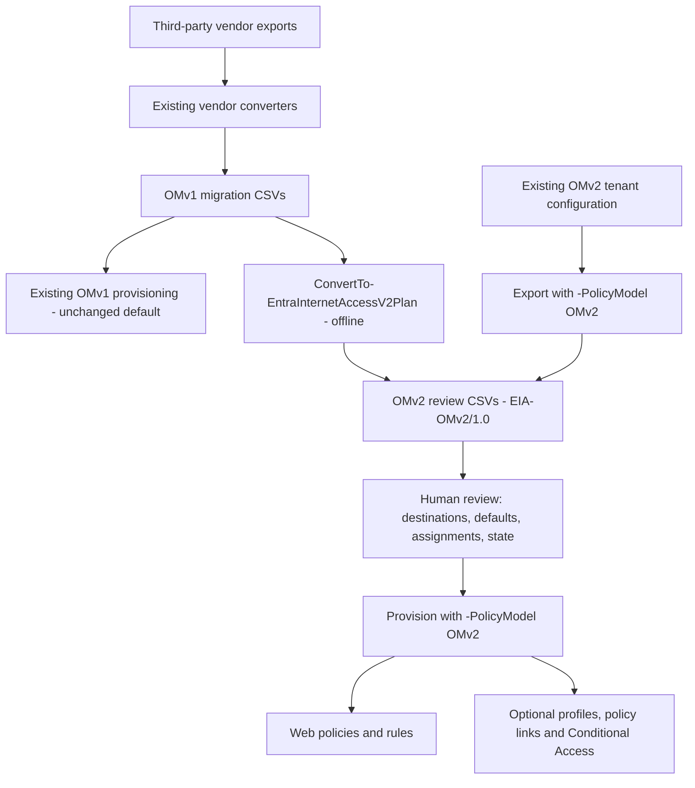

# Web Filtering OMv2: Plan

Updated: 2026-10-30

Status: Implemented locally; read-only tenant preflight passed for one policy.
Live provisioning and enforcement validation remain pending.

## Purpose and review request

Extend Migrate2GSA to support the Web Filtering Object Model V2 (OMv2) in Microsoft
Entra Internet Access, without changing existing OMv1 workflows. OMv2 places
actions on ordered rules and adds an explicit policy default, so migration needs
more than a change of API: rule order, no-match behavior, and assignments must
remain reviewable.

This plan explains the workflow, scope, and remaining validation. The companion
[Decisions](OMv2-Decisions.md) explains the design choices and tradeoffs.
Review is requested on the conversion model, conservative rerun behavior, and
release criteria below. These documents support a design review; implementation
approval also requires the code diff and validation evidence.

## End-to-end workflow

Existing vendor converters are not rewritten. Their previously generated CSVs
can also enter the OMv2 conversion stage. Native OMv2 exports already use the V2
contract and do not need this conversion again.

| Interface | Responsibility |
|---|---|
| `ConvertTo-EntraInternetAccessV2Plan` | Convert OMv1-format policy/profile CSVs into V2 review files without Graph calls. Require an explicit proposed default action. |
| `Start-EntraInternetAccessProvisioning -PolicyModel OMv2` | Preflight reviewed configuration, create missing objects, and reuse equivalent objects. |
| `Export-EntraInternetAccessConfig -PolicyModel OMv2` | Export V2 configuration for review and supported round trips; optionally include full CA definitions. |

Omitting `-PolicyModel` on provisioning or export keeps OMv1 behavior.

## Scope and operating boundaries

The implemented scope is basic Allow/Block URL and web-category rules, ordered
within one generated web policy per source security profile. It includes policy
defaults, optional profile/link/Conditional Access (CA) creation, and export/retry
CSVs. Policy-only provisioning is supported for isolated testing.

Generated rules and profiles start disabled, with `ReviewNeeded=Yes` and
`Provision=No`. Selection for provisioning does not enable a rule. Exported
runtime states, including enabled CA policies, are preserved and require review.

Traffic Forwarding V2, non-web policy conversion, automatic updates/deletion,
and OMv1 cutover are out of scope. Unsupported advanced rules are preserved for
review on export, not silently reduced to supported rules. Existing OMv1 and
non-web links remain untouched.

## Evidence and remaining work

Evidence recorded as of the date above:

| Area | Current evidence | What it does not establish |
|---|---|---|
| Local validation | Manifest/import checks and 47 tests passed; documentation build succeeded with existing unrelated anchor warnings. Tests cover conversion, mocked provisioning/export, conflicts, retries, CA, and OMv1 default dispatch. | Full vendor regression coverage or actual service/datapath behavior. |
| Sample conversion | Shipped EIA and Zscaler migration CSVs produced review plans. | Semantic equivalence of every sample rule or support for every raw vendor export. |
| Tenant preflight | Authenticated Canary `-WhatIf` passed for one Zscaler-derived policy with five disabled URL rules and no profiles. | Successful creation/readback, profile/CA provisioning, or traffic enforcement. |

Complete the following in an explicitly authorized, isolated test tenant:

1. **Validate creation and repeatability.** Create the disabled, unlinked sample
   policy; read it back, rerun unchanged with no duplicate writes, and export it
   for a reviewed round trip.
2. **Validate assignment and failure handling.** Exercise profiles, web links,
   and disabled CA; verify real conflicts stop writes and partial failures leave
   usable retry CSVs. Check the intended environment's feature availability and
   service limits.
3. **Validate enforcement and cutover readiness.** Deliberately enable a limited
   test scope. Verify URL/wildcard/path and category matching, rule priority,
   defaults, ContinueEvaluation across profiles, and OMv1 coexistence. Document
   the separate cutover and recovery procedure before broader rollout.

Release readiness requires successful live checks and reviewer acceptance of
remaining limitations. Read-only preflight is progress, not an end-to-end pass.

## Review entry points

- [User guide and CSV contract](../../website/docs/Convert/EntraInternetAccessV2Plan.md):
  command examples, review fields, and supported behavior.
- [V2 conversion](../../Migrate2GSA/functions/GSA/ConvertTo-EntraInternetAccessV2Plan.ps1)
  and [provisioning orchestration](../../Migrate2GSA/internal/functions/EIA/V2/Invoke-EIAV2Provisioning.ps1):
  transformation and write-safety boundaries.
- [Conversion tests](../../tests/EntraInternetAccessV2Plan.Tests.ps1) and
  [provisioning/export tests](../../tests/EntraInternetAccessV2Provisioning.Tests.ps1):
  executable examples and regression coverage.
